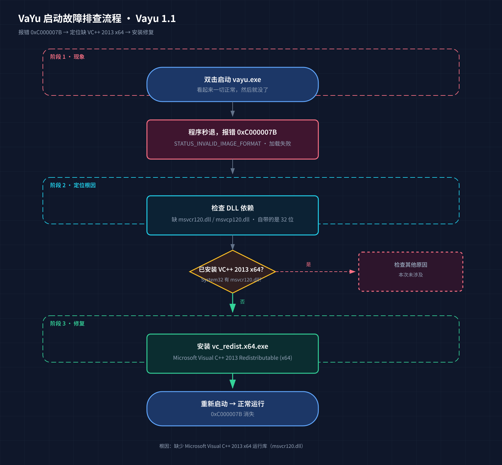

# Vayu 1.1 启动报错 0xC000007B 修复方法

> 缺微软运行库（VC++ 2013 x64），装上后修复完毕。

本仓库记录 VaYu（Vayu 1.1，当前公网发行版）在 Windows 上双击打不开（报错 `0xC000007B`）的完整排查与修复过程，按「报错提示 → 缺什么 → 怎么安装」三步展开，附排查流程图。

---

## 软件与官方下载

VaYu（Vayu，昵称"娲鱼"）是中国科学院古脊椎动物与古人类研究所卢静团队研发的三维表面模型可视化与处理软件，面向全球免费开放，可广泛应用于古生物、生命科学、医学、考古等学科的三维表面模型可视化。

**官方下载地址（免费）：** <https://admorph.ivpp.ac.cn/download.html>

> 本文档针对 Vayu 1.1 版本；若下载页提供更新版本，修复方法同样适用。

## 参考文献

Lu J. **Vayu 1.0, a new set of tools for visualizing surface meshes**[J]. *Vertebrata Palasiatica (古脊椎动物学报)*, 2023, 61(1): 71-80. DOI: [10.19615/j.cnki.2096-9899.221020](https://doi.org/10.19615/j.cnki.2096-9899.221020)

---

## 一、报错提示：双击就退

1. 双击 `vayu.exe`（或桌面快捷方式）
2. 程序窗口一闪而过，甚至根本不出现
3. 没有弹窗、没有日志，就是**秒退**

用命令行手动运行，能看到真正的错误码：

```text
0xC000007B  STATUS_INVALID_IMAGE_FORMAT（映像格式无效）
```

| 错误码 | 含义 | 常见原因 |
|---|---|---|
| `0xC000007B` | 加载 DLL 失败，映像格式无效 | 缺少运行库 / DLL 位宽（32 位 vs 64 位）不匹配 |

> 小知识：`0xC000007B` 里的 "7B" 是系统错误表里「STATUS_INVALID_IMAGE_FORMAT」的编号。看到它，先往 DLL 缺失方向查，不要怀疑显卡、不要怀疑杀毒软件。

---

## 二、缺什么：一个运行库

顺着错误码做依赖检查，定位到两个关键文件：

- `msvcr120.dll`（C 运行时）
- `msvcp120.dll`（C++ 标准库运行时）

这两个文件属于 **Microsoft Visual C++ 2013 Redistributable (x64)**。本机情况是：

- 系统 `System32` 里**没有**这两个文件 → VC++ 2013 x64 运行库未安装
- 安装包/压缩包里自带的这两个 DLL 是 **32 位**版本 → 加载 64 位程序时位宽不匹配，被加载器直接拒绝

一句话说清：**64 位的程序需要 64 位的运行库。程序是 64 位的，而它依赖的运行时 DLL 缺失（或只有 32 位），于是 0xC000007B。**

用个类比：这就像一台需要 220V 电压的设备，你只给它插了 110V 的插座。设备没坏，是供电（运行库）不对。

---

## 三、怎么安装：三步搞定

### 第 1 步：下载官方运行库

从微软官方渠道下载 `vc_redist.x64.exe`（Microsoft Visual C++ 2013 Redistributable (x64)）：

- 微软官方下载页搜索：**Visual C++ Redistributable for Visual Studio 2013 (x64)**
- 注意选择 **x64** 版本，不要选 x86（32 位）

### 第 2 步：安装

图形界面直接双击安装即可。也可以在命令行静默安装：

```powershell
.\vc_redist.x64.exe /install /quiet /norestart
```

### 第 3 步：验证

安装完成后确认 DLL 已就位：

```powershell
Test-Path C:\Windows\System32\msvcr120.dll
# True
Test-Path C:\Windows\System32\msvcp120.dll
# True
```

然后重新启动 `vayu.exe`，即可正常进入程序。

---

## 附：排查与修复流程图



SVG 高清源文件：[vayu-troubleshooting.svg](vayu-troubleshooting.svg)

---

*记录时间：2026-11-02 · 环境：Windows 11 / Vayu 1.1*
