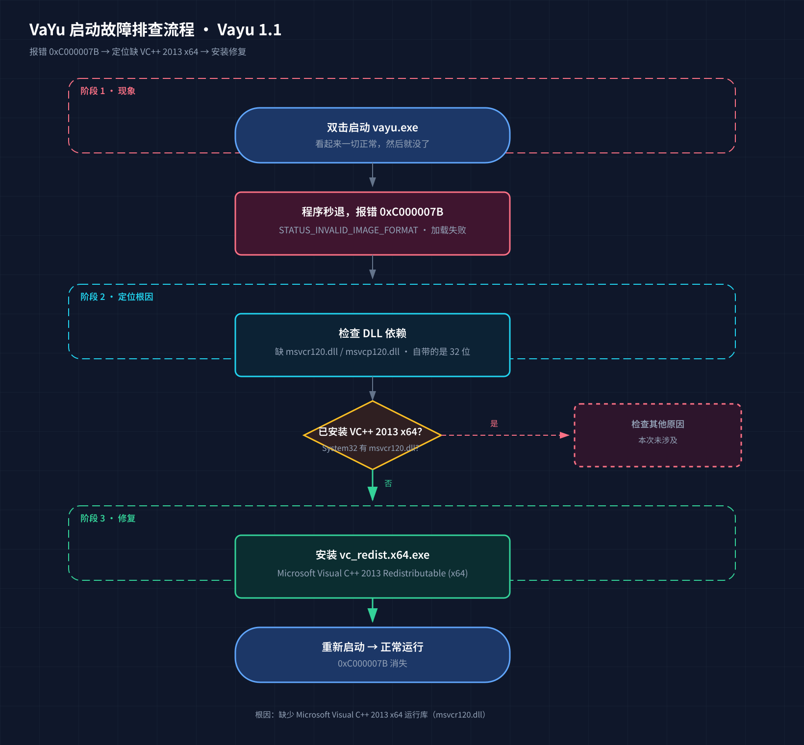

---
AIGC:
    Label: "1"
    ContentProducer: 001191440300708461136T1XGW3
    ProduceID: 9e1a33a1ac5b7b90d6374c8294e78cb0_12db65bfd69611f1b2d8525400393706
    ReservedCode1: Bc780dsP6HmTtX+5es4Lp4Kne2/xjox2yLilC6RSDfAUb9hM5oJxpJYCxxJO6M9pgM6RLjhoXpQBFVc+rjpoNKSyilcfKC+3c2XEm8cpVG6V0hLE9rnFVYsZ3fKyH9av//PjFYGQZhCs8APRlfv4LfPKWllIvmqGtDjW9c0vjKiV87O3WgbTUtnv3bE=
    ContentPropagator: 001191440300708461136T1XGW3
    PropagateID: 9e1a33a1ac5b7b90d6374c8294e78cb0_12db65bfd69611f1b2d8525400393706
    ReservedCode2: Bc780dsP6HmTtX+5es4Lp4Kne2/xjox2yLilC6RSDfAUb9hM5oJxpJYCxxJO6M9pgM6RLjhoXpQBFVc+rjpoNKSyilcfKC+3c2XEm8cpVG6V0hLE9rnFVYsZ3fKyH9av//PjFYGQZhCs8APRlfv4LfPKWllIvmqGtDjW9c0vjKiV87O3WgbTUtnv3bE=
---

# VaYu（Vayu 1.1）启动报错 0xC000007B 排查与修复记录

> 一句话结论：**程序本身没坏，缺一个微软运行库（VC++ 2013 x64），装上就好。**

本文档记录的是 VaYu 当前公网发行版本 **Vayu 1.1** 在 Windows 11 上双击打不开的真实排查经历。整个过程按「报错提示 → 缺什么 → 怎么安装」三步展开，文末附排查流程图。

---

## 一、报错提示：双击就退

现象非常直接：

1. 双击 `vayu.exe`（或桌面快捷方式）
2. 程序窗口一闪而过，甚至根本不出现
3. 没有弹窗、没有日志，就是**秒退**

用命令行手动运行，能看到真正的错误码：

```text
0xC000007B  STATUS_INVALID_IMAGE_FORMAT（映像格式无效）
```

| 错误码 | 含义 | 常见原因 |
|---|---|---|
| `0xC000007B` | 加载 DLL 失败，映像格式无效 | 缺少运行库 / DLL 位宽（32 位 vs 64 位）不匹配 |

这个错误码本身不神秘：**Windows 想把某个 DLL 装进进程时失败了**。要么没有这个 DLL，要么 DLL 的位数对不上。

> 小知识：`0xC000007B` 里的 "7B" 不是随机的，它是系统错误表里「STATUS_INVALID_IMAGE_FORMAT」的编号。看到它，先往 DLL 缺失方向查，不要怀疑显卡、不要怀疑杀毒软件。

---

## 二、缺什么：一个运行库

顺着错误码做依赖检查，定位到两个关键文件：

- `msvcr120.dll`（C 运行时）
- `msvcp120.dll`（C++ 标准库运行时）

这两个文件属于 **Microsoft Visual C++ 2013 Redistributable (x64)**。本机情况是：

- 系统 `System32` 里**没有**这两个文件 → VC++ 2013 x64 运行库未安装
- 安装包/压缩包里自带的这两个 DLL 是 **32 位**版本 → 加载 64 位程序时位宽不匹配，被加载器直接拒绝

一句话说清：**64 位的程序需要 64 位的运行库。程序是 64 位的，而它依赖的运行时 DLL 缺失（或只有 32 位），于是 0xC000007B。**

用个类比：这就像一台需要 220V 电压的设备，你只给它插了 110V 的插座。设备没坏，是供电（运行库）不对。

---

## 三、怎么安装：三步搞定

### 第 1 步：下载官方运行库

从微软官方渠道下载 `vc_redist.x64.exe`（Microsoft Visual C++ 2013 Redistributable (x64)，版本号 v12.0.40664.00 等）：

- 微软官方下载页搜索：**Visual C++ Redistributable for Visual Studio 2013 (x64)**
- 注意选择 **x64** 版本，不要选 x86（32 位）

### 第 2 步：安装

图形界面直接双击安装即可。也可以在命令行静默安装：

```powershell
.\vc_redist.x64.exe /install /quiet /norestart
```

### 第 3 步：验证

安装完成后确认 DLL 已就位：

```powershell
Test-Path C:\Windows\System32\msvcr120.dll
# True
Test-Path C:\Windows\System32\msvcp120.dll
# True
```

然后重新启动 `vayu.exe`，即可正常进入程序。

---

## 附：排查与修复流程图



SVG 高清源文件：[vayu-troubleshooting.svg](vayu-troubleshooting.svg)

---

## 复盘要点（给以后的自己）

- **看到 0xC000007B，先查运行库，别慌**：这是最典型的「缺 DLL / 位宽不匹配」错误码。
- **64 位程序缺 64 位运行库**：别装成 x86 版本，装了也没用。
- **排查顺序**：命令行运行拿错误码 → 查 DLL 依赖 → 比对 System32 是否有对应文件 → 按缺失安装官方运行库。
- **多版本困惑的真相**：本机「看起来有多个 VaYu」是注册表残留了重复卸载记录所致，清理后系统只保留最新版本。

---

*记录时间：2026-11-02 · 环境：Windows 11 / Vayu 1.1（公网发行版）*
*（内容由AI生成，仅供参考）*
